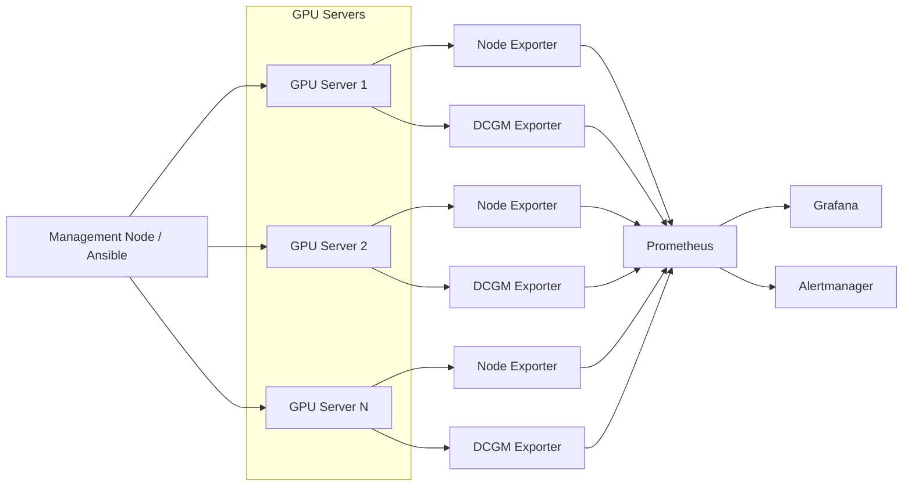
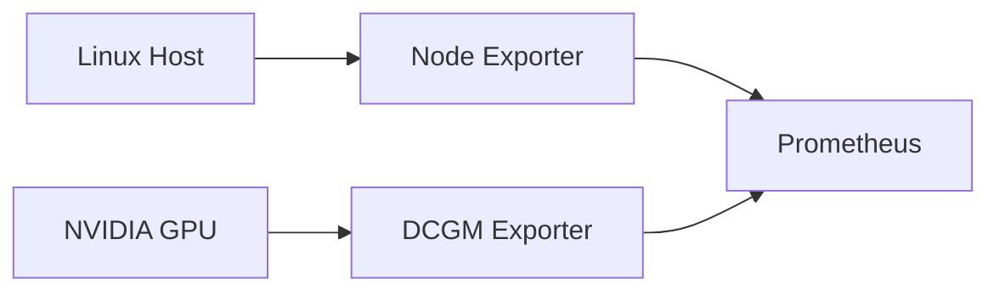
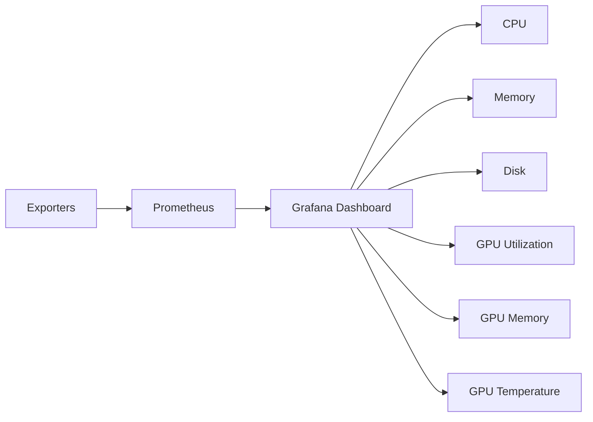
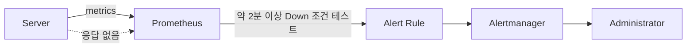
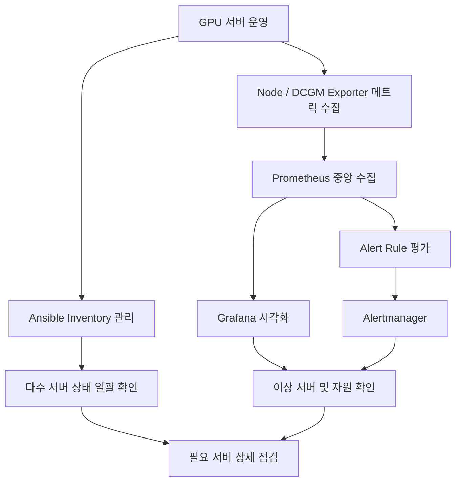

# 충북대학교 소프트웨어학부 GPU 서버 운영 기록

> 학부 서버 관리 근로 중 수행한 **메트릭 수집, 반복 작업 자동화, 모니터링, 시각화, 장애 알림** 구성만 정리한 기록입니다.
>
> 개인 프로젝트, 웹사이트 운영, NAS/SMB, Cloudflare Tunnel 등의 구성은 본 문서에서 제외했습니다.

## 1. 운영 목적

학부 및 대학원 연구 환경에서 사용되는 다수의 GPU 서버를 관리하면서 다음과 같은 문제가 있었습니다.

- 여러 서버의 CPU, 메모리, 디스크 및 GPU 상태를 각각 접속해서 확인해야 함
- GPU 사용률과 메모리 점유 상태를 한눈에 확인하기 어려움
- 서버 수가 늘어날수록 동일한 점검 명령을 반복 실행해야 함
- 서버가 중단되어도 사용자의 연락을 받기 전까지 장애를 인지하기 어려움

이를 개선하기 위해 서버 상태를 중앙에서 수집하고, 반복 작업을 자동화하며, Grafana에서 상태를 시각화하고, 장애 상태를 자동으로 감지하는 구조를 구성했습니다.

---

## 2. 전체 구성



구성의 핵심 흐름은 다음과 같습니다.

```text
서버 상태 수집
    ↓
Node Exporter / NVIDIA DCGM Exporter
    ↓
Prometheus 중앙 수집
    ↓
Grafana 시각화
    ↓
Prometheus Alert Rule
    ↓
Alertmanager 장애 알림

별도 관리 작업
    ↓
Ansible
    ↓
여러 GPU 서버 동시 점검 및 반복 작업 자동화
```

---

## 3. 메트릭 수집

### Node Exporter

각 Linux 서버의 기본 시스템 상태를 수집하기 위해 `Node Exporter`를 사용했습니다.

주요 확인 항목은 다음과 같습니다.

- CPU 사용률
- Load Average
- 메모리 사용량
- 디스크 사용량
- 파일시스템 상태
- 네트워크 송수신량
- 서버 Up/Down 상태

기존에는 서버에 SSH로 접속하여 `top`, `free`, `df` 등의 명령으로 개별 확인해야 했지만, Exporter를 배치한 이후 Prometheus에서 동일한 형식으로 서버 상태를 수집할 수 있도록 구성했습니다.

### NVIDIA DCGM Exporter

GPU 서버 특성상 일반적인 시스템 메트릭만으로는 상태를 파악하기 어려워 NVIDIA GPU 전용 메트릭 수집을 위해 `DCGM Exporter`를 사용했습니다.

주로 확인한 항목은 다음과 같습니다.

- GPU Utilization
- GPU Memory 사용량
- GPU Temperature
- GPU 상태 및 관련 메트릭



이를 통해 CPU/RAM 상태와 GPU 상태를 하나의 모니터링 환경에서 함께 확인할 수 있도록 했습니다.

---

## 4. Prometheus 기반 중앙 모니터링

각 서버에서 Exporter가 제공하는 메트릭을 Prometheus가 주기적으로 수집하도록 구성했습니다.

```text
GPU Server 01 ─┐
GPU Server 02 ─┤
GPU Server 03 ─┤
      ...      ├──> Prometheus
GPU Server NN ─┘
```

Prometheus를 중앙 수집 지점으로 사용하면서 개별 서버에 접속하지 않고도 여러 서버의 상태를 동일한 기준으로 확인할 수 있도록 했습니다.

운영 관점에서는 다음과 같은 흐름으로 활용했습니다.

```text
사용자 장애 문의 또는 정기 점검
        ↓
Prometheus / Grafana 확인
        ↓
CPU / RAM / Disk / GPU 상태 확인
        ↓
이상이 있는 서버 범위 축소
        ↓
필요한 서버에 직접 접속하여 원인 확인
```

즉, Prometheus를 단순히 데이터를 쌓는 용도가 아니라 **장애 발생 시 확인해야 할 서버와 자원의 범위를 빠르게 좁히기 위한 운영 도구**로 사용했습니다.

---

## 5. Ansible 기반 반복 작업 자동화

GPU 서버 수가 많아지면서 모든 서버에 하나씩 SSH 접속하여 같은 명령을 실행하는 방식은 관리 효율이 떨어졌습니다.

이를 개선하기 위해 `Ansible`을 도입하여 여러 서버에 동일한 명령을 동시에 실행할 수 있도록 구성했습니다.

관리 대상은 서버의 역할이나 GPU 종류 등을 기준으로 Inventory에서 그룹화했습니다.

당시 사용했던 Inventory 그룹에는 다음과 같은 형태가 있었습니다.

```text
inventory/
├── gpu
└── gpu_rtx3080
```

관리 대상 서버 역시 ST, WW, JW, TN, NR 및 RTX 계열 서버 등 여러 장비로 구성되어 있었습니다.

### 기존 방식

```text
ssh server01
명령 실행
exit

ssh server02
명령 실행
exit

ssh server03
명령 실행
...
```

### 개선 방식

```text
             Ansible
                │
      ┌─────────┼─────────┐
      ↓         ↓         ↓
  Server 01 Server 02 Server 03 ...
```

sudo 권한이 필요한 작업에서는 Ansible의 privilege escalation을 사용했고, 여러 서버의 Docker 실행 상태 등을 한 번에 확인하는 방식으로 활용했습니다.

예를 들어 다음과 같은 형태의 점검을 수행했습니다.

```bash
ansible <group> -b -K -m shell -a "docker ps"
```

> 위 명령은 당시 사용 방식을 설명하기 위한 대표 예시이며, 실제 Inventory 이름 및 명령 옵션은 작업 상황에 따라 달랐습니다.

Ansible 도입으로 다음 작업의 반복 부담을 줄일 수 있었습니다.

- 다수 서버 상태 확인
- 동일 명령 일괄 실행
- Docker 실행 상태 점검
- 관리자 권한이 필요한 반복 작업 수행
- 특정 GPU 또는 역할별 서버 그룹 단위 관리

---

## 6. Grafana 기반 상태 시각화

Prometheus에 수집된 메트릭을 서버 운영자가 빠르게 확인할 수 있도록 `Grafana`를 사용했습니다.



Grafana를 통해 개별 서버에 직접 접속하기 전에 전체 서버의 상태를 먼저 확인할 수 있었습니다.

특히 GPU 서버에서는 단순히 서버가 살아 있는지만 확인하는 것이 아니라 다음과 같은 상황을 구분하는 데 활용했습니다.

```text
서버 자체 장애인지
        ↓
CPU / Memory 부족인지
        ↓
GPU 자원 점유 문제인지
        ↓
특정 서버만 발생한 문제인지
        ↓
전체 환경에서 발생한 문제인지
```

이처럼 시각화를 장애 원인 분석의 첫 단계로 사용했습니다.

---

## 7. Alertmanager 기반 장애 감지

사용자의 연락을 받은 이후 서버 장애를 확인하는 수동적인 방식에서 벗어나기 위해 Prometheus Alert Rule과 `Alertmanager`를 구성했습니다.

대표적으로 서버가 일정 시간 동안 응답하지 않는 상황을 감지하도록 `InstanceDown` 유형의 Alert Rule을 테스트했습니다.



개념적인 Alert Rule은 다음과 같습니다.

```yaml
groups:
  - name: server
    rules:
      - alert: InstanceDown
        expr: up == 0
        for: 2m
        annotations:
          summary: "Instance down"
```

> 위 YAML은 당시 구성의 목적과 동작을 설명하기 위한 기록용 예시입니다. 실제 운영 당시의 전체 Alert Rule 파일 원본은 현재 기록에 남아 있지 않아 동일한 설정이라고 단정하지 않습니다.

중요한 부분은 단순히 Alertmanager를 설치한 것이 아니라, 실제로 서버 Down 상태를 만들어 **일정 시간 이후 Alert가 발생하는지 테스트했다는 점**입니다.

---

## 8. 운영 흐름

전체 서버 관리 과정은 다음과 같은 형태로 정리할 수 있습니다.



운영 업무를 기능 기준으로 정리하면 다음과 같습니다.

| 구분 | 사용 기술 | 역할 |
| --- | --- | --- |
| 시스템 메트릭 수집 | Node Exporter | CPU, RAM, Disk, Network 등 서버 상태 수집 |
| GPU 메트릭 수집 | NVIDIA DCGM Exporter | GPU 사용률, GPU Memory, Temperature 등 수집 |
| 중앙 수집 | Prometheus | 여러 서버의 메트릭 통합 수집 및 조회 |
| 자동화 | Ansible | 다수 서버의 상태 확인 및 반복 명령 일괄 실행 |
| 시각화 | Grafana | 서버 및 GPU 자원 상태 Dashboard 구성 |
| 장애 감지 | Prometheus Alert Rules | 조건 기반 장애 상태 판단 |
| 알림 처리 | Alertmanager | 발생한 Alert를 운영자가 확인할 수 있도록 전달 |

---

## 9. 구축 전후 변화

### Before

```text
서버 이상 발생
    ↓
사용자가 관리자에게 연락
    ↓
관리자가 서버별 SSH 접속
    ↓
top / free / df / nvidia-smi 등 개별 확인
    ↓
문제 서버 탐색
```

### After

```text
Node Exporter + DCGM Exporter
            ↓
       Prometheus
       ↙        ↘
  Grafana     Alertmanager
     ↓             ↓
상태 시각화      장애 감지
       ↘          ↙
         관리자 확인
              ↓
      Ansible / SSH 점검
```

핵심 변화는 **문제가 발생한 뒤 모든 서버를 직접 확인하는 방식에서, 서버 상태를 지속적으로 수집하고 이상이 있는 서버를 먼저 찾아가는 방식으로 운영 절차를 바꾼 것**입니다.

---

## 10. 사용 기술

```text
Linux / Ubuntu
Prometheus
Grafana
Alertmanager
Node Exporter
NVIDIA DCGM Exporter
Ansible
Docker
NVIDIA GPU
SSH
```

Docker는 서버 내 GPU 작업 환경과 서비스 상태 확인 과정에서 함께 다뤘으며, NVIDIA Container 환경에서 NVML 관련 문제를 점검한 경험도 있습니다.

---

## 11. 이 경험에서 배운 점

서버 운영을 시작했을 때는 문제가 생긴 서버에 접속하여 직접 확인하고 해결하는 방식에 가까웠습니다. 하지만 관리해야 하는 서버가 늘어나면서 이러한 방식만으로는 효율적인 운영이 어렵다는 것을 경험했습니다.

그래서 **수집 → 중앙 모니터링 → 시각화 → 알림 → 자동화**의 흐름을 구성했습니다.

이를 통해 인프라 운영에서는 단순히 장애를 해결하는 능력뿐만 아니라 다음 요소가 중요하다는 것을 배웠습니다.

1. 서버 상태를 지속적으로 관찰할 수 있어야 한다.
2. 장애가 발생했을 때 문제 범위를 빠르게 좁힐 수 있어야 한다.
3. 동일한 작업을 여러 서버에서 반복하지 않도록 자동화해야 한다.
4. 장애를 사용자가 먼저 발견하기 전에 운영자가 확인할 수 있는 체계가 필요하다.

학부 서버 관리 근로를 통해 여러 GPU 서버를 직접 운영하면서 이러한 운영 체계를 실제 환경에 적용해볼 수 있었습니다.

---

## 12. 한 줄 요약

> 다수의 학부 GPU 서버를 대상으로 **Node Exporter와 NVIDIA DCGM Exporter를 이용해 시스템/GPU 메트릭을 수집하고, Prometheus와 Grafana로 중앙 모니터링 및 시각화 환경을 구성했으며, Alertmanager를 이용한 장애 감지와 Ansible 기반 반복 관리 작업 자동화를 수행했습니다.**
